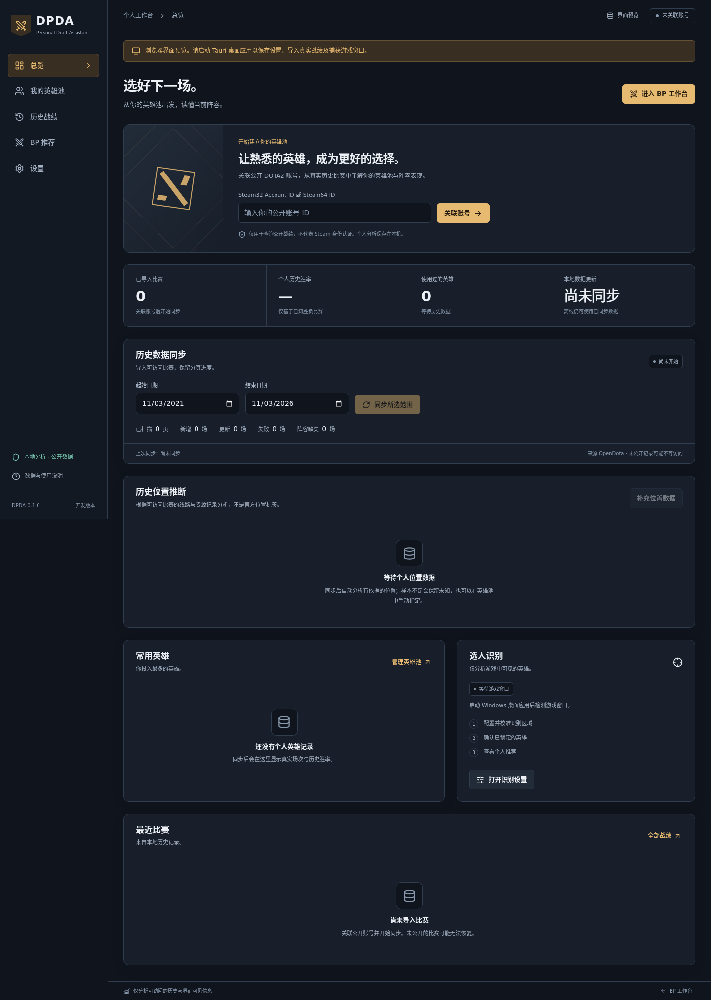

# Dota Personal Draft Assistant

[](https://github.com/tiansongyu/dota2_assistant/actions/workflows/ci.yml) [](https://github.com/tiansongyu/dota2_assistant/actions/workflows/windows.yml)

**DPDA** 是以个人英雄池为边界的 DOTA2 BP 助手：同步公开战绩，在本地分析熟练度、历史对抗与协同，再为当前阵容推荐 Top 3—5 英雄。

当前为 **0.1 开发版本**。真实 OpenDota 导入、SQLite、个人池、可解释评分和 Linux 调试工具已有实现与测试。Windows 构建、打包和 CI 环境的安装后进程启动检查已通过；真实 DOTA2 截图准确率、游戏内性能和清洁机安装尚未验收。具体证据见 [测试记录](docs/testing.md) 和 [进展](docs/development-progress.md)。

[Linux API 调试](docs/linux-debug.md) · [Windows 构建](docs/windows-build.md) · [数据来源](docs/data-sources.md) · [识别与校准](docs/vision-system.md) · [已知问题](docs/known-issues.md)

面向首批 100–1,000 位用户的 [公开战绩服务方案](docs/public-service-proposal.md) 已形成提案，包含网站、个人账号、同步队列和成本模型；公开服务尚未实现或上线，当前下载仍为桌面与 Linux 调试版本。



上图来自实际浏览器渲染的空状态，仅展示界面；不代表已经导入用户数据或验证游戏识别。

## 下载开发预览版

[v0.1.0-dev.1 发布页](https://github.com/tiansongyu/dota2_assistant/releases/tag/v0.1.0-dev.1) 提供以下产物及 SHA-256 校验文件：

| 平台 | 下载 | 用途 |
| --- | --- | --- |
| Windows x64 | [NSIS 安装包](https://github.com/tiansongyu/dota2_assistant/releases/download/v0.1.0-dev.1/dpda-windows-x64-setup.exe) | 未签名的桌面开发版本；需 VC++ x64 Runtime 和 WebView2 |
| Linux x86_64 | [无界面调试工具](https://github.com/tiansongyu/dota2_assistant/releases/download/v0.1.0-dev.1/dpda-linux-debug-x86_64.tar.gz) | 验证 API、SQLite、统计和回测；不含 Linux 游戏捕获 |

安装前阅读 [Windows 前置条件](docs/windows-build.md) 或 [Linux 使用说明](docs/linux-debug.md)。构建提交、验收边界和产物摘要见 [发布核验记录](docs/reports/release-v0.1.0-dev.1.md)。

`main` 已增加自动位置分析、完整逐场详情和 Linux 图形调试启动脚本；这些更新尚不在上述 `v0.1.0-dev.1` 包内，请使用下方源码构建命令。数据库会从 Schema 1 升至 2，旧版本不能读取升级后的数据库；调试启动脚本会创建独立副本。

## 能做什么

- 输入公开 Steam32 / Steam64 ID，同步可访问历史，按日期过滤、限流重试、暂停恢复、去重并保存 SQLite。
- 查看全历史、最近 20/50 场、90/180 天及一年统计；缺失结果和位置保留未知。
- 自动、手动或混合维护英雄池；从同队经济、补刀和分路推断位置候选，允许手动覆盖、优先级和明确排除。
- 手动输入可见阵容，离线生成推荐、样本量、平滑与区间说明。没有足够样本时不伪造本局胜率。
- 在 Windows 使用 WGC 与经校准的 OpenCV 头像模板识别；候选、锁定、冲突和手动纠错分开处理。
- 主窗口与轻量悬浮窗，提供紧凑模式、透明度、拖动、位置记忆和恢复交互快捷键。

只分析当前界面可见英雄和预先同步的公开历史。不读取游戏内存、不注入、不截获游戏网络、不使用 GSI/Overwolf、不查询当前对手身份、不自动操作游戏。

## Linux：优先验证真实数据

Linux 版本用于开发调试，不面向普通游戏用户。独立 `dpda-debug` 不依赖 GTK、WebView 或 OpenCV。需要 Rust 1.90 或更高版本及 C 编译工具；SQLite 随 Rust 依赖编译。

```bash
git clone https://github.com/tiansongyu/dota2_assistant.git
cd dota2_assistant
cargo build --locked --release -p dpda-debug
./target/release/dpda-debug --help
```

按 [Linux 调试指南](docs/linux-debug.md) 执行 API 探测、分页同步、数据库核验与回测。网络探测与常规离线测试分开运行；报告中会区分成功、失败、缺少凭证和未实现接口。公开测试账号只用于工程 smoke，不会自动成为你的个人账号。

## 桌面开发

技术栈：Tauri 2、Rust、React、TypeScript、Vite、SQLite、OpenCV。精确版本在 `Cargo.lock` 和 `apps/desktop/package-lock.json`，不依赖全局 npm 包。

### Ubuntu 22.04 / 24.04 调试 UI

先安装开发依赖（仅安装步骤需要管理员权限）：

```bash
sudo apt-get install build-essential pkg-config libwebkit2gtk-4.1-dev libgtk-3-dev \
  libayatana-appindicator3-dev librsvg2-dev libopencv-dev clang libclang-dev
npm ci --prefix apps/desktop
cd apps/desktop
npm run tauri dev
```

Node 要求至少 22.12，建议 24 LTS。Linux 下可以验证同步、英雄池、手动 BP 和界面；捕获模块会明确报告 Windows 专用。`npm run dev` 只启动浏览器界面预览，不能调用数据库或真实同步。

已有 CLI 数据库时，可从仓库根目录直接打开带真实数据的图形界面：

```bash
python3 scripts/start-linux-debug.py --db ./local/dpda.db --account YOUR_STEAM_ID --build
```

这条命令需要 Linux 图形桌面和上述开发依赖，会备份数据库到独立调试会话并选中该账号，不覆盖源库。终端会输出 `--resume` 命令，后续用它保留会话中的设置。界面提供所有已导入比赛的分页、原始字段、逐场位置依据和英雄统计。

### Windows

安装 Rust MSVC、Visual Studio C++ Build Tools、Node 24、WebView2、LLVM 和 OpenCV，然后按 [Windows 构建指南](docs/windows-build.md) 构建。CI 的 `Windows build` 工作流生成包含 OpenCV 运行库和第三方许可的 NSIS 安装包，并执行安装后进程启动检查；结果以对应 commit 的 Actions 记录为准。

## 第一次使用

1. 在“设置”或初始化向导输入自己的公开 Account ID。输入 ID 是查询公开资料，不是 Steam 身份认证。
2. 选取历史日期范围并同步。公开记录可能不足 3—5 年；页面显示实际导入量、缺失阵容与来源状态。
3. 同步后程序自动补充有请求上限的比赛详情并分析位置；总览可继续“补充位置数据”。`lane_role` 不直接等于一至五号位，推断会显示样本、未知和多位置候选。“我的英雄池”允许手动覆盖或恢复自动，不要求先填写位置。
4. “BP 推荐”默认采用自动位置；也可按当前计划指定具体位置。选择天辉/夜魇，输入已锁定英雄与禁用英雄。未完成视觉校准时也可以先验证完整的手动流程。
5. 查看 Top 3—5 与展开依据。明确排除的英雄永不进入候选；不足三个候选时只显示实际数量。

### 找到 Steam ID

DOTA2 个人资料中的好友 ID 通常可作为 Steam32 Account ID。若 Steam 个人主页 URL 为 `steamcommunity.com/profiles/7656...`，数字部分是 Steam64，完整复制即可。自定义 `/id/昵称` 链接不能直接作为 Account ID。程序以字符串接收 Steam64 并在 Rust 中精确转换。

### 图像识别与模板

进入“设置”的可视化校准工具，载入自己采集的选人截图，标注十个英雄槽位、选人界面标记，以及独立的锁定/空槽标记，导出校准文件和裁剪图片。分别为尺寸、DPI、UI 版本建 profile。持续稳定的头像仍可能是预选，缺少锁定证据时只作为候选。

公开英雄肖像可下载到自己的本地缓存：

```bash
python3 scripts/fetch-hero-templates.py --output artifacts/hero-templates
```

该缓存不进 Git，也不随安装包分发。公开肖像并不保证与当前 UI 槽位匹配；需使用真实截图评估。配置、标注格式、评估命令和验收矩阵见 [视觉系统](docs/vision-system.md)。

### 悬浮窗快捷键

- `Ctrl+Shift+F8`：显示／隐藏已打开的悬浮窗。
- `Ctrl+Shift+F9`：显示悬浮窗并恢复交互。

只有恢复快捷键成功注册，才允许启用点击穿透。设置页也可关闭穿透。独占全屏和多显示器表现尚待 Windows 实测，优先使用无边框窗口。

## 数据与算法限制

OpenDota 只能返回其可访问的比赛，不保证恢复私密或从未记录的历史。同步读取实际限流响应；中断后重新扫描并去重以避免 offset 漂移。`patch`、位置和其他缺失字段不编造。

推荐评分是可解释排序指标，**不是本局获胜概率**。历史胜率、平滑值、区间和样本分别展示。普通模式推荐排除 Turbo 等不同规则的比赛；仍不能据此声称只用了天梯数据。外部当前版本/分段统计没有接入可靠来源时，该分项不计分。见 [推荐模型](docs/recommendation-model.md)。

## 测试与贡献

```bash
npm ci --prefix apps/desktop
./scripts/check.sh
```

门禁运行 Rust 格式、严格 Clippy、Rust 和许可收集器测试，以及 TypeScript、ESLint、Vite build。网络测试显式执行，CI 默认不消耗你的 API 配额。新增识别能力必须附来源清晰的真实截图评估；合成单元测试不能替代实机报告。

目录与设计见 [架构](docs/architecture.md)、[数据库](docs/database.md)、[开发计划](docs/development-plan.md)、[贡献指南](CONTRIBUTING.md)。Outdraft 的公开功能对照见 [参考分析](docs/outdraft-reference.md)。

## 常见问题

**没有推荐？** 检查是否已有历史和足够位置证据、当前英雄池模式、明确排除/位置覆盖，以及英雄是否已选或被禁用。可以在总览继续补充详情；证据不足不会被强行填成某个位置。

**同步为空或出现 429？** 检查账号 ID、公开比赛设置、日期与平台配额；空响应不等于没有玩过比赛。稍后继续同步，本地记录不会因此删除。

**断网还能使用吗？** 已同步的战绩和英雄目录保存在本地，断网时仍可输入阵容并计算推荐。当前阵容在应用重启后清空。首次导入和数据更新需要网络。

**数据放在哪里？** 桌面使用 Tauri 应用数据目录下的 `io.dpda.desktop/dpda.sqlite`，日志在同级 `logs`。Linux CLI 使用你指定的 `--db` 路径。删除前退出应用并先备份，详见 [隐私说明](docs/privacy.md)。

**会自动选择英雄吗？** 不会。程序只提供建议，用户自己操作 DOTA2。

## 许可证

项目原创代码采用 [MIT](LICENSE)。英雄名称与 DOTA2 美术属于各自权利方；dotaconstants 元数据保留上游 MIT notice，不能据此重新授权 Valve 图片。依赖与素材说明见 [第三方声明](THIRD_PARTY_NOTICES.md)。本项目与 Valve、OpenDota、STRATZ、Outdraft 无隶属或背书关系。
