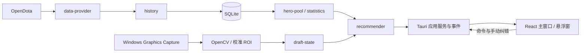

# DPDA 技术架构

状态：实施中。核验日期：2026-11-02。当前宿主为 Ubuntu 22.04；Windows 游戏集成尚未验收。

DPDA 采用 Tauri 2 + Rust + React/TypeScript + SQLite。本地数据库是个人历史、配置和同步进度的持久化来源；React 通过 Tauri commands 访问应用服务，不能直接调用外部战绩接口。捕获、视觉、历史同步和推荐各自独立于窗口 UI。

## 模块与边界

| 模块 | 职责与依赖 |
| --- | --- |
| `domain` | 稳定英雄 ID、比赛记录、账号规范化；跨 IPC 的 match_id/Steam64 均用字符串 |
| `data-provider` | OpenDota HTTP、超时、限流、解析；静态英雄资料 |
| `persistence` | SQLite 迁移、参数化查询、事务、同步断点、设置 |
| `history` | 日期范围分页导入、暂停恢复、导入接口已返回的阵容、缺失保留、去重 |
| `statistics` | Beta 平滑、Wilson 区间、时间衰减、有效样本与评估 |
| `hero-pool` | 聚合历史、近期窗口、自动/手动/混合英雄池、明确排除和手动位置 |
| `capture` | 指定 DOTA2 窗口的 Windows Graphics Capture、帧生命周期 |
| `vision` | 经校准的 ROI、OpenCV 匹配、候选差距、空槽与锁定证据 |
| `draft-state` | 多帧确认、冲突、已选阵容、手动纠错；不把稳定悬停等同锁定 |
| `recommender` | 本地候选过滤、可解释排序、时间回测，不输出未经校准的本局胜率 |
| `apps/desktop/src-tauri` | 服务编排、事件、命令、后台任务、窗口与日志 |

## 事实与推断

原始比赛缺失字段保留 `null`。`lane_role` 是线路标注，不能转换成五位置后假称为事实。第一版五位置由用户指定。个人胜负由 `player_slot` 阵营与 `radiant_win` 计算，缺任一字段则未知。

推荐分数统一为 0—100 的排序指标。缺失总体克制/版本数据时记录缺失并回退，不造总体胜率。统计报告保留原始场次、平滑值、区间和样本量。一次比赛在一项阵容条件的联合证据中只计一次。

视觉识别需要经版本、分辨率和 DPI 绑定的配置。未经截图验证的布局不得默认启用。选人界面和锁定状态必须有独立视觉证据；只有候选识别不触发已锁定推荐更新。

## 并发与安全

网络异步运行，数据库短事务提交断点；CPU 视觉工作在后台线程执行。长时间任务可取消，应用启动恢复已保存进度。阵容有实际变化才重算。设置、个人历史在本地；不上传截图，不读取游戏内存，不注入，不监听游戏网络，不连接 GSI。

IPC 为版本化快照与显式命令，可供未来第二屏协议复用；当前不开放网络监听端口。只向打包本地页面授予必要 Tauri capabilities；外部 API 固定在 Rust 服务。

## 依赖依据

- [Tauri 2 prerequisites](https://v2.tauri.app/start/prerequisites/)：Windows MSVC、WebView2；Linux WebKitGTK。
- [Tauri command bridge](https://v2.tauri.app/develop/calling-rust/)：显式命令与序列化边界。
- [Tauri capabilities](https://v2.tauri.app/security/capabilities/)：限制前端原生访问。
- [rusqlite Connection](https://docs.rs/rusqlite/latest/rusqlite/struct.Connection.html)：事务、busy timeout、数据库校验。
- 数据覆盖、配额与许可证见 [data-sources.md](data-sources.md)；参考代码和 Windows API 依据见 [vision-system.md](vision-system.md)。

不采用无许可证参考仓库的代码。依赖解析后的精确版本由 Cargo.lock/package-lock.json 锁定；不升级到 Tauri 3 alpha。
