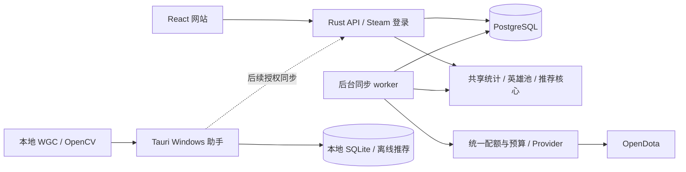

# DPDA 公开服务方案

状态：proposed。核验日期：2026-11-03。目标：首批 100–1,000 位活跃用户。本文是技术与运营提案，服务尚未实现或上线，未购买 API 或服务器。

## 建议与范围

建议建设自己的 Web 个人战绩服务，使用付费 OpenDota 按需同步、PostgreSQL 持久缓存和现有 Rust 分析核心。Windows 桌面端继续负责游戏画面识别与悬浮窗。先服务主动使用产品的账号，再根据实际费用、覆盖缺口和维护能力评估自有录像解析。

公开服务允许任何人注册并查询自己的可访问战绩。个人分析、英雄池设置和同步任务默认仅本人可见；公开分享是以后单独设计的功能。网站不是无限制转发 OpenDota 的通用 API，也不会因注册用户变多就自动扫描所有玩家。

用户数量不等于并发请求量。下文费用按 1,000 人全部每天活跃计算；机器配置是压测起点，不是已证明能承载 1,000 人同时查询的规格。

首版提供 Steam 登录、历史分页与筛选、个人英雄池、自动位置候选、数据覆盖说明、手动阵容推荐、同步进度、数据导出与删除。默认由历史证据分析位置，不要求用户先判断一至五号位。数据不足时保留未知并继续补充详情，不把四/五号位候选强行拆成确定位置。

网站与 Windows 助手的能力边界：

| 场景 | 运行位置 |
| --- | --- |
| 战绩同步、持久缓存、个人统计与位置分析 | 服务端 |
| 浏览历史、调整英雄池、手动输入阵容并推荐 | Web，亦可由桌面端使用 |
| 自动发现 DOTA2 窗口、WGC 截图、OpenCV、悬浮窗 | Windows 本地 |
| 断网推荐 | 保留桌面 SQLite 与本地算法；后续增加账号授权的数据同步 |

公开服务不会让浏览器直接获得现有 WGC 和置顶窗口能力。游戏截图默认留在本机；未来桌面联动只传用户授权的必要数据。原有桌面与 Linux 调试功能继续保留。

## 架构

采用模块化单体：API 与 worker 使用同一代码库，作为两个进程运行。首版用 PostgreSQL 同时保存业务数据、同步任务和会话，避免立即增加多套数据库与消息系统。静态页面可使用 CDN；个人 API 响应不得被公共 CDN 缓存。Redis 在需要多实例高频缓存或限流后再评估，录像对象存储在真正接入录像时再增加。

| 组件 | 建议 | 依据与当前状态 |
| --- | --- | --- |
| Web | React + TypeScript + Vite，沿用设计系统 | 现有依赖由 lockfile 固定；需增加 HTTP transport 和登录页面 |
| API | Rust + Axum + Tokio | [Axum 0.8.9 文档](https://docs.rs/axum/0.8.9/axum/)说明 Router、State、Tower 中间件及 Tokio 集成；尚未加入项目 |
| 数据层 | PostgreSQL 18 + SQLx PostgreSQL 驱动 | [SQLx 0.9.0 文档](https://docs.rs/sqlx/0.9.0/sqlx/)支持 Tokio；实施时锁版本并验证与 workspace 的构建兼容性，不启用不必要的 SQLite 驱动 |
| 队列 | PostgreSQL 任务表、短事务领取、租约 | [PG 18 SELECT](https://www.postgresql.org/docs/18/sql-select.html)说明 `SKIP LOCKED` 适合队列消费者；它本身不提供公平调度或仅执行一次的保证 |
| 部署 | Linux、容器或 systemd、HTTPS 反向代理、独立 PostgreSQL | 首版无需 Kubernetes；数据库采用受支持版本，参考[官方支持周期](https://www.postgresql.org/support/versioning/) |

已有 Rust 核心继续测试，不要求重写成 JavaScript。Web 入口与桌面入口共享应用服务，但各自持有独立的认证、存储和任务实现。

## 数据源与授权边界

| 数据源 | 首版定位 | 已核实与待核实 |
| --- | --- | --- |
| OpenDota | 首选历史与详情来源，购买 API key 后按用量接入 | 公开 GET 已在项目验证；付费认证调用、结算页和商业展示/缓存/再分发条件尚未验收 |
| STRATZ | 预留适配接口 | 当前 token、覆盖、商业授权和配额没有完成认证验证，不把旧公告当作当前承诺 |
| Valve Web API / GC / 录像 | 后续独立研究 | 自建不继承历史库；部分传统接口存在问题，不作为首版可用性的前提 |

OpenDota 的 MIT 软件许可不能替代数据、Valve 美术或商业再分发授权。上线前应核实所用服务条款是否覆盖缓存、向注册用户展示、导出和拟定商业模式；不明确的范围需取得服务方确认。首版保留来源、抓取时间、覆盖与缺失说明，不开放原始数据转售接口。[现有来源记录](data-sources.md)

核验时，`https://api.opendota.com/api/metadata` 返回免费日额度 3,000、免费分钟额度 60、付费分钟额度 3,000。这是 2026-11-03 的部署值，不是长期 SLA，也不是每位 DPDA 用户各有一份额度。响应头、429、账户合同和结算页优先于旧文档或仓库默认配置。

官方前端代码将 API 价格设为每 100 次 0.01 美元，后端按计费单位向上取整；本次未完成付费调用或购买。网站普通订阅与 API 用量计费不能混为一谈。[价格界面源码](https://github.com/odota/web/blob/master/src/components/Api/Api.tsx)、[计费实现](https://github.com/odota/core/blob/master/svc/apiadmin.ts)

不假设自建采集马上可以替代 OpenDota：当前 [ApiFetcher](https://github.com/odota/core/blob/master/svc/fetcher/ApiFetcher.ts) 已注释常规 `GetMatchDetails` 调用并说明接口问题。源码状态不是本项目对所有 Steam 接口的实测结论；自动 GC 登录和历史录像覆盖也未完成验证。

## 用户流程与账号隔离

1. 用户经 Steam 官方网站完成 OpenID 2.0 登录，服务端校验断言后建立 DPDA 会话。它验证 Steam 身份，不授予私人 DOTA2 战绩读取权限；不接收用户 Steam 密码、Steam Guard 验证码或个人 API key。[Steam 官方网站登录说明](https://partner.steamgames.com/doc/features/auth#website)
2. 显示数据来源、保存内容与地区、更新规则，让用户主动启动个人同步。输入账号 ID 的公开查询与登录身份分开；后台持续同步只作用于已验证、已启用的本人账号。
3. 优先导入近期列表，展示实际取得的场次及统计；继续分页回填用户请求日期内的可访问历史。列表完成不等于详情完整，历史无记录也不能直接解释成从未玩过。
4. 后台按近期与常用英雄采样补齐详情，计算位置候选、熟练度与推荐依据。完整历史仍可逐步导入，不把首轮详情预算误称为历史条数上限。
5. 用户可以查看任务进度、暂停更新、导出自己的数据或删除账号。后续更新优先服务活跃账号，休眠账号降低频率。

OpenID 2.0 不是 OpenID Connect。实现应验证签名/直接校验响应、Steam provider、回调地址、请求绑定与 nonce，防止伪造账号和重放；不能从 `claimed_id` 拆出数字就信任。实际回调、退出和重放测试是上线门禁。

Web 使用服务端会话与 `Secure`、`HttpOnly` cookie，写操作做 CSRF 防护和来源校验。用户身份从会话取得，不能由请求中的 `user_id` 决定。所有历史、导出、任务状态和设置接口验证归属；队列、缓存键和统计快照包含账号范围与数据版本。推荐缓存还需包含英雄池设置版本、算法版本、阵容和位置。Steam64 和比赛 ID 在 JSON 中保持字符串；Steam32 的数据库类型必须覆盖完整 `u32`。

Steam Web API 条款涉及用户请求、数据保存告知、key 保密及禁止截取密码等要求。若接入该 API，需按实际使用范围落实；部署国家与隐私政策须在公开上线前确定。[Steam Web API 条款](https://steamcommunity.com/dev/apiterms)

## 同步调度与成本控制

网站读取本地数据，不为每次页面访问同步调用上游。用户刷新页面不会直接增加 OpenDota 请求量。首版建议只有一个统一上游调度器；以后增加 worker 时，配额与预算仍必须集中协调，不能给每个进程各算一份额度。

- 任务类别区分近期更新、历史回填、详情补充和统计重算。每个用户只有一份同类活动任务，重复点击返回已有任务。
- 调度器使用按用户轮转、优先级与等待时间提升。限制单个账号连续领取量，为新用户与近期更新保留预算，避免大历史账号独占。
- 全站分钟速率、并发、每日预算和月费用上限分别配置。领取网络任务前原子预留请求预算，未知计费结果保守计入；达到费用上限暂停网络补充，已有数据仍可查询。
- `match_id + 数据源 + 字段版本` 去重详情请求，多个订阅用户涉及同一比赛时复用必要字段。上游返回的缓存响应仍可能计费；只有命中自己的缓存才保证本次不调用上游。
- 使用幂等写入和任务租约，网络请求在数据库事务外执行。工作进程崩溃后允许重新领取，因此按“至少一次执行”设计；写入必须检查租约代次、账号状态与删除代次，防止旧任务覆盖新结果或恢复已删数据。
- 429 遵守响应及可用的 `Retry-After`，无法确认重置时间时延后并降低频率；超时与暂时故障有限重试、带抖动退避，保留断点。不可持续重试耗尽的额度。
- 详情字段不完整时标记覆盖与下一次允许尝试时间，不在用户每次访问时重复请求；首版不默认提交付费录像解析请求。
- 日常增量从最新页读取并去重，周期性重叠扫描和按预算回补，以应对上游延迟补入旧比赛；不能遇到第一条已知记录就永久跳过后续回填。
- 个人分析按数据/设置/算法版本更新并缓存；更改英雄池或确认阵容后才重算相应推荐，不在每次读取页面时重读全历史。

缓存过期或数据源中断时，页面显示最后成功更新时间、实际覆盖区间、缺失字段和失败原因，并提供旧数据。网页可访问不等于新比赛已同步。

## 费用模型

以下是假设演算，不是实际流量、服务器报价或支出承诺。假设 1,000 位活跃用户，每人有 3,000 场可访问历史；列表每页 100 场，首轮每人请求 100 场详情；日常每人每天检查列表 4 次，产生 1 条需要获取的新比赛详情。尚未计入跨用户比赛去重。

| 项目 | 请求计算 | 按上述公开单价估算 |
| --- | --- | --- |
| 首次历史列表 | `1,000 × 30 = 30,000` | 3 美元，一次性基础量 |
| 首轮详情补充 | `1,000 × 100 = 100,000` | 10 美元，一次性基础量 |
| 日常列表与新详情 | `1,000 × (4 + 1) × 30 = 150,000/月` | 15 美元/月基础量 |
| 若首月同时发生上述项目 | `280,000` | 28 美元基础量 |

实际费用还包括终止分页探测、更多比赛、登录后刷新、人工刷新、失败重试、补页、详情重取和其它端点。若完整 3,000 场详情都逐一拉取，仅这部分就是约 300 万次、按上述单价约 300 美元；列表仍需另计。不能把 15 美元说成“1,000 人服务的总月费”。所有 HTTP 失败也并非都自动免计费。

可采用的预算公式为：`计费请求数 = 列表页 + 唯一缺失详情 + 重取/补页/其它计费请求`。费用看上游计费数量，页面访问量主要影响自有服务。月上限必须经实际预算确定，并在软件中执行硬限制。

基础设施另计：应用计算、PostgreSQL、备份、域名、带宽和监控。建议先以 API/worker 2–4 vCPU、4–8 GB RAM，加独立 PostgreSQL 与可扩展 SSD 做压测；托管 PostgreSQL 优先降低备份和恢复负担。磁盘容量先测标准化记录、索引和备份体积再购买；地区、供应商和预算未确定，本文不编造总价或 SLA。

## 存储与接口草案

下列是职责划分，不是已经创建的数据库或可调用端点。桌面 SQLite 不直接暴露给多用户网站。

| 数据 | 关键边界 |
| --- | --- |
| `users`、`steam_links`、`sessions` | 账号绑定唯一；会话可撤销；记录同步启用状态 |
| `user_matches` | 用户与比赛的关联、本人槽位和结果；所有访问检查归属 |
| `match_facts`、`slot_facts` | 按稳定比赛 ID 复用最小比赛/槽位信息；不保存非必要的其他玩家身份、昵称、聊天 |
| `hero_pool_settings`、`analysis_snapshots` | 用户范围、数据修订号、规则/模型版本；用户明确排除优先 |
| `sync_jobs`、`sync_cursors`、`provider_budget` | 活动任务去重、租约、重试、检查点、实际请求与费用预算 |

共享比赛记录即使去掉昵称，也不能直接宣称完全匿名。删除账号时先停调度、撤销会话并增加删除代次，再删除个人关联、配置、分析、导出与任务；在途任务提交前再次检查删除代次。不再被其他启用用户需要的比赛事实应回收。共享字段的保留必须符合数据来源条款和适用删除请求，备份保留窗口也要在公开政策中说明；备份恢复后重新执行删除记录，避免账号复活。

建议的首版 API 以 `/api/v1/me` 为身份边界：

- `GET /matches`：服务端游标分页，按时间与比赛 ID 稳定排序，支持英雄/位置/版本筛选及未知项；有限制的页大小。
- `GET /summary`、`GET /hero-pool`：读取版本化统计，包含更新时间、来源、覆盖与推断依据。
- `POST /sync`、`GET /sync/{job_id}`：受预算约束地创建/复用任务，返回 `202` 与任务状态；查询任务也检查归属。
- `PUT /hero-pool`、`POST /recommendations`：设置与输入校验，复用现有硬过滤和可解释算法；评分不是本局胜率。
- `POST /exports`、`DELETE /account`：本人导出和删除；导出文件/下载地址必须验证身份或采用短时授权。

列表返回分页结果，统计接口不附带完整逐场历史。进度首版可使用受限轮询；如增加 SSE，事件流同样绑定用户，不能广播整个服务的任务。

## 现有工程迁移

| 现有代码 | 改造方向 |
| --- | --- |
| `crates/domain`、`statistics`、`hero-pool`、`recommender` | 复用模型和算法；保留位置未知、多候选、样本量与时间回测约束 |
| `apps/desktop/src-tauri/src/lib.rs` | 将自动位置合并和推荐编排提取为共享应用服务；不能把全局 `active_profile` / `AppState` 直接变成 HTTP 后端 |
| `crates/history` | 从具体 SQLite `Database` 解耦；检查点与数据提交保持同事务，取消标志改成任务状态 |
| `crates/data-provider` | 增加服务端 API key、全局预算、密钥脱敏和统一调度；现有进程内限流不能代表多进程全站限流。现有 `parse_role_evidence` 只保留指定用户本方五人，不能直接跨用户共享；需先提取去除玩家身份的共享槽位事实，再生成各用户证据，或将缓存继续按账号/阵营隔离 |
| `crates/persistence` | 保留本地 SQLite，新增 PostgreSQL 实现与服务端迁移；参数、事务和类型映射分别测试 |
| `apps/desktop/src/services/api.ts`、`pages/History.tsx` | 抽出 transport 和可共享 UI；全量快照/浏览器切片改为 Web 服务端分页，Tauri transport 继续可用 |

建议新增 `apps/server`、`apps/web`、共享应用服务和 PostgreSQL 存储模块。具体 crate 名称在实施时确定；目前没有这些服务的运行命令。

## 分阶段验收

| 阶段 | 交付 | 验收证据 |
| --- | --- | --- |
| S0：数据与运营验证 | 数据源使用范围、凭证配置方式、地区与预算、接口契约 | 授权范围可核对；实际带 key 请求验证响应与计费；不把测试连接成功当作商业授权 |
| S1：多用户内部验证 | 登录、PG、任务队列、真实历史、分页、自动分析 | 账号 A 无法访问 B 的查询/任务/导出；伪造登录和重放被拒绝；重复同步无重复行；重启可恢复；桌面回归通过 |
| S2：100 人试运行 | 公开入口、进度、缓存、预算、导出与删除 | 经用户主动请求的真实同步报告；429/断网/进程崩溃演练；费用上限有效；删除与备份恢复测试通过 |
| S3：扩至 1,000 人 | 容量与维护流程、监控、按实测扩容 | 按实际数据规模测 API P95、错误率、队列等待、PG 连接与存储、缓存命中、每活跃用户上游调用量；同时报告数据新鲜度和未知率 |
| S4：选择性自有采集 | 仅在收益明确时接入可用录像解析或另一数据源 | 比较详情覆盖改善、每场成本、上游授权、实际维护时间；不以用户数量代替收益评估 |

建议试运行验收目标：缓存查询 P95 小于 500 ms（注明硬件、数据量、网络和并发模型），无跨账号数据泄露、无已确认任务静默丢失、预算耗尽后仍可查看旧数据。指标均未实测，也不构成对外 SLA。先以小批量真实用户测费用与覆盖，再逐批开放；不要同时为 1,000 人无上限回填所有详情。

开发阶段继续运行现有 Rust/前端质量门禁，新增 PostgreSQL 集成、鉴权隔离、幂等恢复和预算测试。负载/故障测试使用明确标记的合成或授权数据，不靠大量付费 API 请求制造压力。上线前完成备份恢复、最小权限、密钥轮换和日志脱敏；日志不保留会话、API key 或完整个人 API 响应。

网站统计样本只代表服务实际覆盖的用户与比赛，不能直接作为全体 DOTA2 玩家的克制结论。当前版本/位置/分段总体统计仍须可靠来源与独立评估；公开服务不会改变现有推荐分数与预测胜率的区别。

## 尚未确定

- 域名、主要用户地区、部署地区、月度总预算及是否收费。
- OpenDota 当前合同对本产品具体缓存、展示和导出方式的适用范围；STRATZ 的实际令牌条件。
- Steam 登录正式回调验证、服务端依赖构建、付费 API 响应、真实负载及运维成本。
- Windows 真实截图识别、悬浮窗与游戏性能的原有验收仍独立进行，不因 Web 方案完成而标记通过。

这些问题不妨碍先实现可测试的服务端模块；其中部署地区、数据使用范围和预算需在公开上线前落实。本文只交付方案，不宣称网站已经可用。
